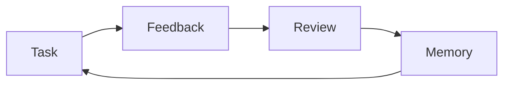

# Visual responses in Otto

Sessions, bots and staged canvas conversations share `AgentConversationBody`.
Replies now use `AssistantResponsePresentation` to keep a useful visual with the
opening takeaway and caption. The original transcript remains intact.

## Agent contract

Shared provider guidance asks for the smallest presentation that improves
understanding: Mermaid for relationships and flows, Markdown tables for comparisons,
images or artifact links for actual results, and brief text for simple answers.
The agent must keep uncertainty and verification status in the visible explanation.

A long answer can mark its overview explicitly:

````markdown
Otto would learn from your feedback. This is a proposed flow.



Your reviewed feedback changes what happens on the next task.

<!-- otto:details -->

## Supporting explanation

Full explanation, limitations, and evidence go here.
````

The divider is recognized only on a standalone line outside a code fence and is
removed from rendered text. This is a Markdown presentation contract, not a new
provider wire protocol. Older replies remain compatible: unmarked answers retain every block,
including complete requested writing and all composed visuals. The complete answer is always
available. A visual placed below a misplaced divider is still surfaced.

## Surfaces

- The conversation displays the overview directly, without opening another node.
- Explore opens a dedicated large sheet without narrowing the conversation.
- Full explanation opens a 420-point text drawer over the conversation, without resizing
  the visual. It shows supporting content directly, without Overview tabs or repeated
  diagrams, tables, or images. Explicit replies use the content after the divider;
  older replies retain their prose and code. The original full transcript stays copyable.
  The selected response is a snapshot, so subsequent messages do not replace it.
- Canvas cards open an expanded response sheet; chat and staged conversations use
  the side inspector directly. Exploration does not replace the canvas layout.
- Mermaid's enlarge control works anywhere the shared Markdown renderer is used,
  including canvas notes. Expanded diagrams support trackpad magnification.
- Relative response images resolve from the owning agent's working directory.
- A source/error fallback and the accompanying caption remain available if a
  diagram cannot render. Existing bundled renderer CSP and source limits remain.

Native email drafts and inbox snapshots use the [chat result card contract](CHAT_RESULT_CARDS.md).
Other custom interactive UI uses existing widget.create or browser nodes. Raw HTML is
not executed in chat. This release does not add a general inline HTML executor,
a new chart language, or synchronized audio highlighting.

## Validation

`AssistantResponsePresentationTests` covers the Echo learning loop, caption and
caveat retention, short answers, comparisons, images, misplaced dividers, literal
markers in code, and incomplete fences. Existing Markdown/Mermaid tests cover
parsing, resources, and bounded renderer messages. Provider adapter tests verify
that the visual-response guidance is present on new and resumed native harness
turns.

Manual checks use the native conversation in Otto Dev: open a response containing a
Mermaid diagram, explore it, open Full explanation, enlarge the diagram, and
check the same response from a canvas card. Also check a short answer, a comparison,
and invalid Mermaid input. The renderer timeout covers initial loading as well as
rendering so a missing ready message cannot leave an indefinite spinner.

Diagram labels retain natural SVG sizing with horizontal scrolling, rather than shrinking
to fit a narrow card. The JavaScript dispatch returns void to WebKit; completion arrives
through the existing bridge. Tables use readable headers and more generous cell spacing.
Session rail spinners replace provider logos while starting/running; user prompts align
to the trailing edge. The compositor thinking orb accompanies live thinking steps.
